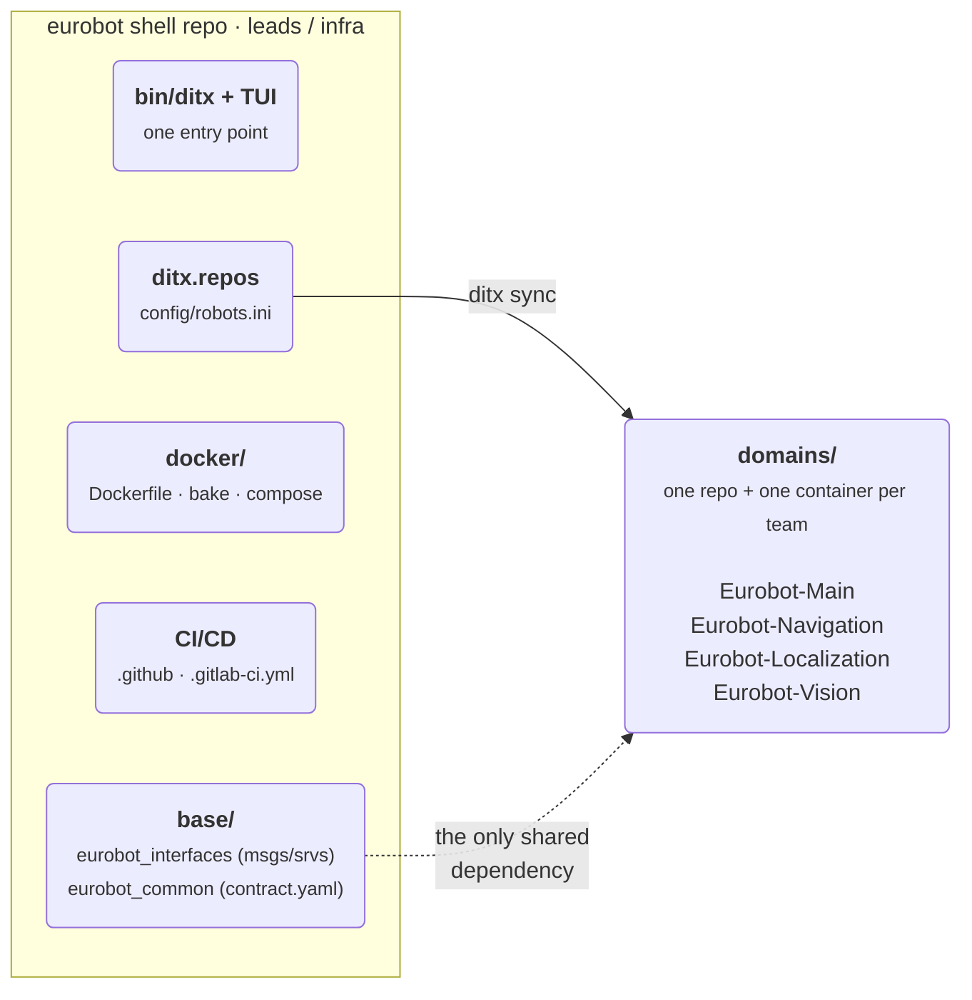
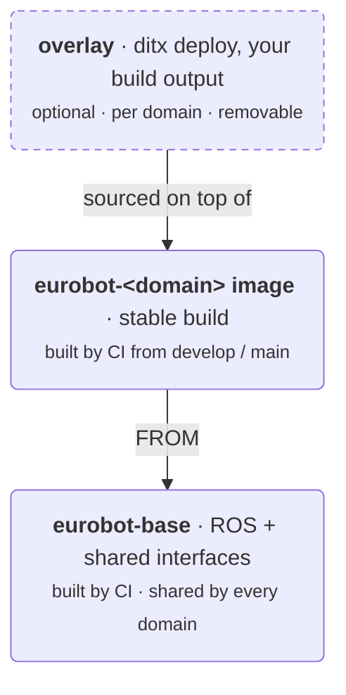
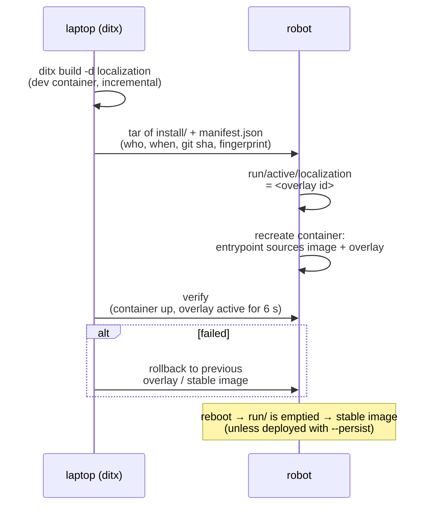
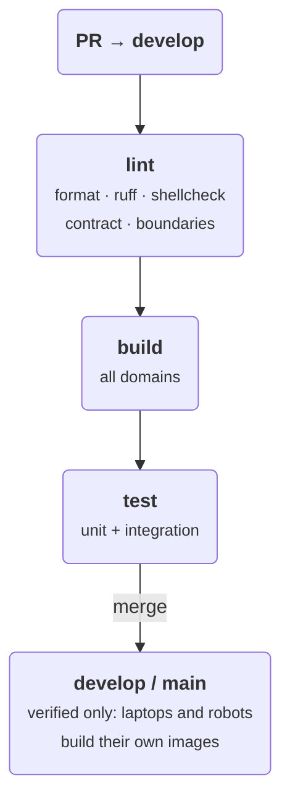

# Architecture

## One shell, many domains

| Concept | Where | Rule |
|---|---|---|
| **Shell** | this repo | Tooling, CI, images, interfaces, which domains exist. Changes here affect everyone, so they need a lead's review (CODEOWNERS). |
| **Domain** | `eurobot-<domain>` repo → `domains/<domain>` | One team, one container on the robot, one colcon workspace. Packages are named `<domain>_*`. |
| **Module** | a ROS package inside a domain | Anything the team wants. Each one reports to the startup handshake. |
| **Contract** | `base/eurobot_common/contract.yaml` | Every topic and service that crosses a domain boundary, with its type and QoS. Code uses generated constants; it never spells the name. |

Domains **never depend on each other's packages** (`ditx lint` enforces this).
They talk only through the contract. Each team can therefore build, test and deploy alone,
and a contract change is a reviewed PR to the shell instead of a Notion table that drifts.

## Layers: build once, overlay only what you change

* **Every** container, on every robot and every laptop, starts from the same `eurobot-base`.
  Because the interfaces are compiled once, two teams can't each compile a different
  version of a message.
* Each layer has **its own install space** (`build/<distro>-<arch>/<layer>/install`), and they are
  sourced in order. You rebuild only your layer, incrementally. A "delete install/ and rebuild
  everything" moment means you crossed a boundary, i.e. you changed the base. Then build it
  explicitly with `ditx build --base` and get a new base image through CI.
* The base carries a **fingerprint** of all interface definitions. An overlay records the
  fingerprint it was built against, and a robot refuses an overlay whose fingerprint does not
  match its image. You get a clear message instead of a mysterious crash mid-match.

## The robot runs images, never source

* There is no compiler on the robot and nobody edits code there. What runs is always
  *image tag + overlay id*, and `ditx overlays -r white` shows who pushed which commit and when.
* Every container logs its overlay manifest on start, so the logs show exactly which code
  produced them.
* Same code for every robot: robot differences live in `config/robots.ini` (what runs, domain
  id, arch) and `<domain>_bringup/config/robots/<robot>.yaml` (parameters). A robot is never a
  git branch.

## CI/CD

* The pipelines only call `ditx ci <stage>`. **Whatever passes locally passes in CI**, and a
  red CI job can be reproduced with the same command.
* Domain repos run the same stages through a reusable workflow, with the other domains
  synced at `develop`. A localization PR is therefore tested *together with* navigation, main and vision.
* Lint runs before human review and is the baseline that AI-written code must also meet:
  formatting, lint, the interface contract and domain boundaries.

## Where things are decided (ADRs)

Decisions that are expensive to undo get a short record in `docs/adr/`. Start with
[0001](adr/0001-shell-and-domains.md).
