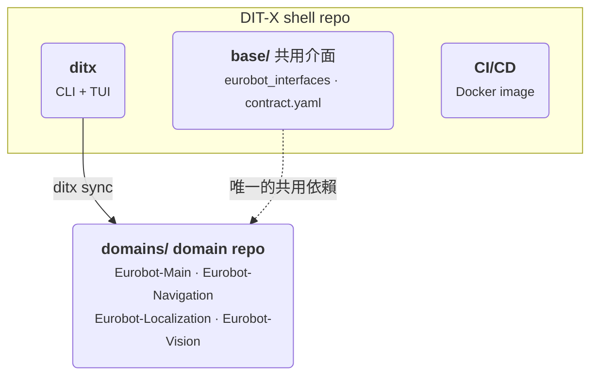

<span class="dit-eyebrow">DIT Robotics · Eurobot</span>

# DIT-X Docs { .dit-hero-title }

**DIT-X** 是 DIT Robotics 的 Eurobot 軟體平台，由 **shell repo** 與各小組的 **domain repo** 組成，本 repo 即為 shell repo。你只需使用 **`ditx`** 這一個指令，即可完成取得程式碼、建置、測試、部署至機器人、復原與查看日誌等工作。



## 快速開始

```bash
git clone https://github.com/DIT-ROBOTICS/DIT-X.git && cd DIT-X
./install.sh            # ditx 上 PATH、Tab 補全
ditx sync && ditx build && ditx test --integration
```

!!! tip "初次使用？"
    請依序完成 [教學 → 新手入門](tutorials/index.md)。全部完成約需一個下午，你將從零開始走完「修改程式 → 部署至模擬機器人 → 復原」的完整流程。

## 如何使用本手冊

| 如果你想… | 請參閱 |
|---|---|
| 從零開始，逐步操作 | [教學](tutorials/index.md)：新手入門 → 中級 → 進階 |
| 查詢指令的參數 | [指令總覽](reference/commands.md) |
| 查詢設定檔欄位 | [設定檔](reference/config.md) |
| 排除遇到的問題 | [疑難排解 FAQ](reference/faq.md) |
| 了解設計背後的考量 | [設計文件](architecture.md)（英文） |
