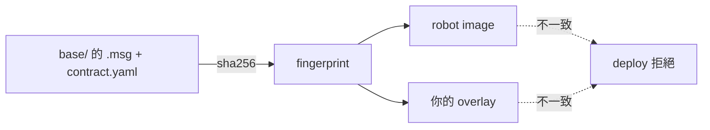
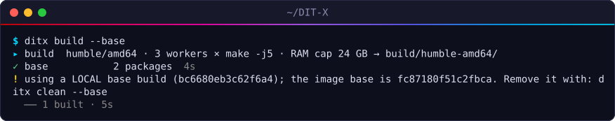
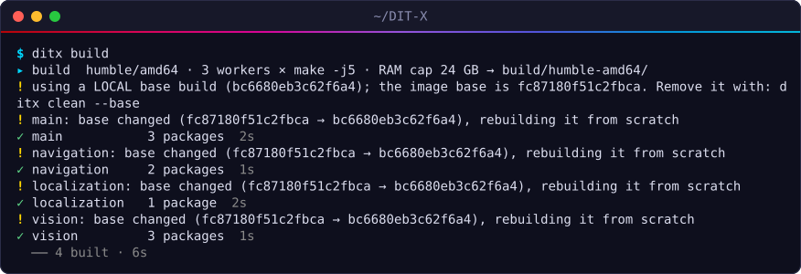
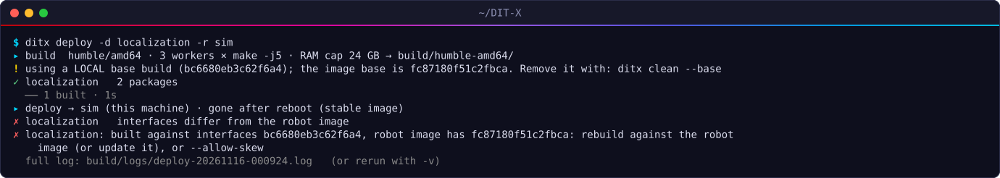
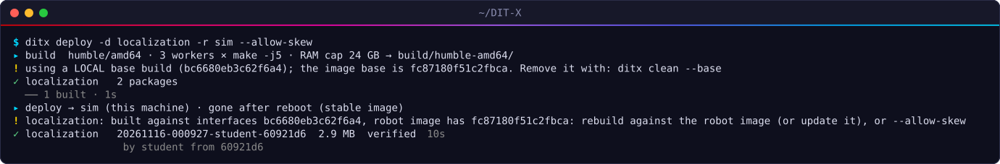
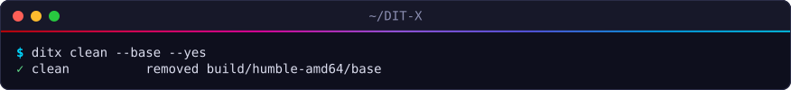

# 11 修改共用介面

**目標**：了解 `base/` 的特殊之處、修改後需要執行的步驟，以及 `ditx` 如何防止介面不一致的程式在機器人上執行。

**時間**：約 20 分鐘

## 背景

`base/` 存放**每個 domain 都會使用**的內容：

| 位置 | 內容 |
|---|---|
| `base/eurobot_interfaces/msg`、`srv` | 自訂的 message 與 service |
| `base/eurobot_common/contract.yaml` | 跨 domain 的 topic 清單（[05](../beginner/05-contract.md)） |
| `base/eurobot_common` | `StartupReporter`，以及自動產生的 `contract` 常數 |

這些檔案會計算出一個**指紋（fingerprint）**，也就是所有 `.msg/.srv/.action` 與 `contract.yaml` 的雜湊值（16 個字元）。image、你在本機的建置，以及每個 overlay 都會記錄自己是根據哪個指紋建置的。



如果 overlay 與機器人上 image 的指紋不同，兩邊的 message 定義可能不一致，導致 DDS「能連線但收不到資料」，這類錯誤非常難以追查。因此 `ditx deploy` 會直接拒絕部署。

## 前置條件

- 已完成 [07 部署 overlay 與復原](../intermediate/07-deploy.md)
- `ditx up -r sim` 正在執行

## 步驟

### 1. 修改介面

修改任一介面，例如在 `contract.yaml` 新增一個 topic，或在
`base/eurobot_interfaces/msg/ModuleHeartbeat.msg` 新增一個欄位。

### 2. 在本機建置 base

image 中已包含一份 base。若要使用修改後的版本，必須在本機另外建置一層：

```bash
ditx build --base
```



!!! warning "`--base` 只會建置 base"
    接著務必再執行一次 `ditx build`，讓每個 domain 以新的 base 為基礎重新建置。

```bash
ditx build
```



`ditx` 偵測到 base 變更後，會自動從頭重新建置受影響的 domain。

### 3. 整合測試

```bash
ditx test --integration
ditx contract md          # 改了 contract.yaml 的話，重新產生 docs/contract.md
```

### 4. 嘗試部署：部署遭拒

```bash
ditx deploy -d localization -r sim
```



這是**預期的結果**：機器人上的 image 仍使用舊介面。正確的做法是提交 PR（見步驟 7），合併後在機器人上重新建置 image（見 [14](14-real-robot.md) 第 3 步），讓機器人的 base 也換成新介面。

### 5.（僅限測試）強制部署

如果確定你的修改與這個 domain 無關（例如只是在介面合約（contract）中新增其他小組的 topic），可以執行：

```bash
ditx deploy -d localization -r sim --allow-skew
```



!!! danger "請勿在比賽用機器人上使用 `--allow-skew`"
    此選項僅供測試時略過檢查；警告仍會照常輸出，日誌中也會留下記錄。

### 6. 清理環境

```bash
ditx rollback -d localization -r sim --yes
ditx clean --base --yes     # 回到 image 裡的 base
```



### 7. 提交變更

1. 將 PR 送至 **shell repo** `DIT-X`，`CODEOWNERS` 會自動指派審查者。
2. 在 PR 範本的 **Interfaces changed?** 勾選 Yes，並標記受影響 domain 的負責人。
3. 不相容的變更請使用 `feat(base)!:`，並在提交訊息內文加上 `BREAKING CHANGE:`。
4. 合併後，各 domain 重新建置；機器人也要重新建置 image，才會用上新的 base。

## 摘要

- `base/` 的指紋決定哪些元件可以一起執行。
- 本機流程：`ditx build --base` → `ditx build` → `ditx test --integration`。
- 指紋不一致時，部署會遭到拒絕；`--allow-skew` 僅限測試時使用。

## 下一步

[12 新增 domain](12-new-domain.md)
