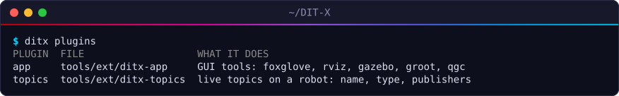
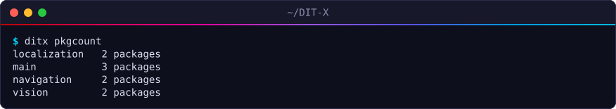
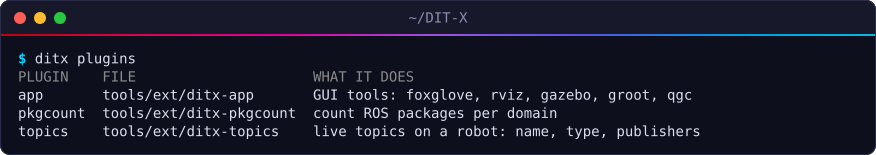
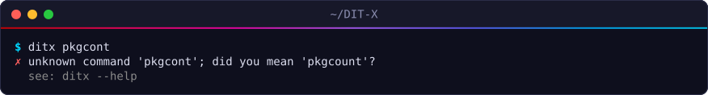

# 13 撰寫 plugin

**目標**：在不修改 `ditx` 本身的情況下，新增自訂子指令 `ditx pkgcount`。

**時間**：約 10 分鐘

## 背景

與 `git`、`cargo`、`kubectl` 相同，任何名為 **`ditx-<name>`** 的可執行檔，只要放在 `tools/ext/` 或 `PATH` 中，就能以 `ditx <name>` 執行。plugin 會自動顯示在 `ditx help`、`ditx plugins` 與 TUI 的 **Plugins** 分頁。

`ditx` 執行 plugin 時，會提供下列環境變數：

| 變數 | 內容 |
|---|---|
| `DITX_ROOT` | 工作區根目錄 |
| `DITX_DRY_RUN` | 執行 `ditx -n <name>` 時為 `1` |
| `DITX_VERBOSE` / `DITX_QUIET` | 指定 `-v` / `-q` 時為 `1` |

檔案第二行的 `# ditx-plugin: <說明>` 即為 `ditx help` 中顯示的單行說明。

## 前置條件

- 已完成 [02 第一次建置與測試](../beginner/02-first-build.md)

## 步驟

### 1. 檢視現有的 plugin

```bash
ditx plugins
```



這兩個都是以 Python 撰寫的範例，示範如何重複使用 `ditx` 本身的模組：

- `ditx-topics`：讀取 `robots.ini`，並在機器人的容器中執行指令。
- `ditx-app`：整合外部工具（[ROS2X](https://github.com/SeanChangX/ROS2X)），只負責傳入機器人的
  `ROS_DOMAIN_ID` 與 discovery 設定，不另外建立 GUI 環境。

### 2. 撰寫 Bash plugin

```bash title="tools/ext/ditx-pkgcount"
#!/bin/bash
# ditx-plugin: count ROS packages per domain
set -euo pipefail
cd "$DITX_ROOT"
for d in domains/*/; do
  n=$(find "$d" -name package.xml -not -path '*/build/*' | wc -l)
  printf '%-14s %s packages\n' "$(basename "$d")" "$n"
done
```

```bash
chmod +x tools/ext/ditx-pkgcount
```

### 3. 執行

```bash
ditx pkgcount
```



此指令現在已成為 `ditx` 的一部分：

```bash
ditx plugins
```



輸入錯誤時，`ditx` 也會提供建議：



!!! warning "plugin 必須自行處理 dry-run"
    `ditx -n pkgcount` 只會設定 `DITX_DRY_RUN=1`，plugin 本身必須檢查此變數。會變更任何內容的 plugin 都必須支援 dry-run，TUI 的 dry-run 模式才有意義。

### 4. 宣告參數

在 `# ditx-plugin:` 之後加上 `# ditx-arg:`，TUI 就會列出這些參數讓使用者從選單挑選，Tab 自動完成也會提供候選值。plugin 仍需自行解析參數（例如使用 argparse），宣告只用於介面。以 `tools/ext/ditx-app` 為例：

```python
# ditx-plugin: GUI tools: foxglove, rviz, gazebo, groot, qgc
# ditx-arg: tool choice:foxglove|rviz|gazebo|groot|qgc required  GUI tool to open
# ditx-choice: foxglove  Foxglove bridge on ws://localhost:8765 (every type decodes)
# ditx-choice: rviz  RViz2 window (ROS2X desktop image)
# ditx-arg: -r,--robot choice:robots  target robot from config/robots.ini
```

| 欄位 | 說明 |
|---|---|
| 名稱 | `tool` 為位置參數；`-r,--robot` 為選項 |
| 種類 | `flag`、`text`、`choice`、`multi` |
| 候選值 | 寫在種類後方的冒號之後：以豎線分隔的固定值（如上例的 `tool`），或來源名稱 `robots`、`domains`、`packages`、`arches` |
| `required` | 未設定時，TUI 不允許執行 |
| `# ditx-choice:` | 上一個參數某個值的單行說明，顯示在 TUI 選單與 Tab 自動完成中 |

### 5. 規則

- 輸出、註解與說明一律使用英文，與 `ditx` 其他部分保持一致。
- 必須通過 `ditx lint`（Bash 會以 shellcheck 檢查，`tools/ext/ditx-*` 中的 Python 也會以 ruff 檢查）。
- 對整個團隊有用的 plugin，請送 PR 加入 `tools/ext/`；僅供個人使用的，請放在 `~/.local/bin/`。

## 摘要

- 將 `ditx-<name>` 放在 `tools/ext/` 或 `PATH` 中，即可執行 `ditx <name>`。
- 第二行的 `# ditx-plugin:` 為指令說明；`# ditx-arg:` 讓 TUI 與 Tab 自動完成提供參數選單。
- 透過 `DITX_ROOT` 取得工作區路徑，並自行處理 `DITX_DRY_RUN`。

## 下一步

[14 arm64 與實體機器人](14-real-robot.md)
