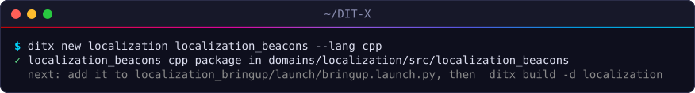
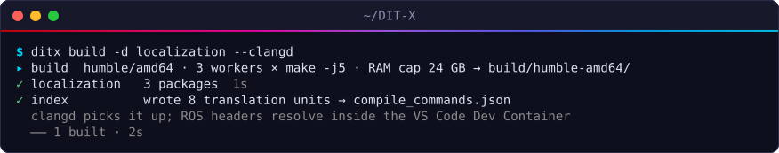
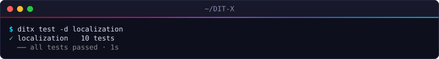

# 15 C++ 開發環境

**目標**：撰寫一個 C++ 套件（package），並讓編輯器的「移至定義」、自動完成與錯誤提示都能正確找到 ROS 的標頭檔。

**時間**：約 15 分鐘

## 背景

ROS 的標頭檔位於 dev container 中（`/opt/ros/humble/include`），而不在你的電腦上，因此直接以編輯器開啟專案時會出現大量錯誤標示。DIT-X 的解決方式如下：

1. **clangd** 讀取 `compile_commands.json`，取得每個檔案的編譯方式。
2. `ditx index` 將每個套件的 `compile_commands.json` 合併至工作區根目錄。
3. 工作區在容器中掛載於**與主機相同的路徑**，因此檔案中的路徑在兩邊都一致。
4. 以 VS Code Dev Container 開啟工作區，clangd 在容器內執行，即可找到所有 ROS 標頭檔。

## 前置條件

- 已完成 [04 第一個套件](../beginner/04-first-package.md)
- 已安裝 VS Code 與 **Dev Containers** 擴充功能（開啟工作區時會提示安裝，清單位於 `.vscode/extensions.json`）

## 步驟

### 1. 建立 C++ 套件

```bash
ditx new localization localization_beacons --lang cpp
```



```text
localization_beacons/
├── CMakeLists.txt
├── include/localization_beacons/beacons.hpp   純邏輯，不依賴 ROS → 可以直接單元測試
├── package.xml
├── src/beacons_node.cpp                       node 只負責收送資料
└── test/test_beacons.cpp                      gtest
```

!!! tip "將演算法與 ROS 分離"
    將演算法寫在 `beacons.hpp` 這類不 include ROS 的檔案中，node 只負責「接收 message → 呼叫演算法 → 發布 message」。如此一來，演算法可以直接用 gtest 測試，不需要啟動 ROS。

### 2. 建置並產生 compile_commands.json

```bash
ditx build -d localization --clangd
```



`--clangd` 相當於建置完成後再執行一次 `ditx index`。新增或刪除 `.cpp` 檔案後，請重新執行。

```bash
ditx test -d localization
```



### 3. 以 Dev Container 開啟

在 VS Code 中按下 ++ctrl+shift+p++，選擇 **Dev Containers: Reopen in Container**。

`.devcontainer/devcontainer.json` 使用 `eurobot-dev` image，與 `ditx build` 使用的相同，並已預先設定：

- 工作區掛載於與主機相同的路徑
- `--network=host`，可直接對機器人執行 `ros2 topic echo`
- clangd、Python、ruff、YAML 與 ROS 擴充功能
- 與 `ditx build` 共用 ccache volume

開啟 `beacons_node.cpp`，按住 ++ctrl++ 並點擊 `rclcpp::Node`，確認編輯器會跳至 ROS 的標頭檔。

!!! warning "請勿安裝 Microsoft C/C++ 的 IntelliSense"
    它會與 clangd 衝突；`.vscode/settings.json` 已將其停用，`.vscode/extensions.json` 也將其列為不建議安裝。

### 4. 格式與 lint

存檔時，clangd 會依照 `.clang-format` 自動格式化。推送前請執行：

```bash
ditx lint -d localization          # clang-format、ruff、contract、domain 邊界
ditx lint --fix -d localization    # 自動修正格式
```

### 5. 建置 Debug 版本

```bash
ditx build -d localization --build-type Debug
```

預設為 `RelWithDebInfo`（包含最佳化與除錯符號）；只有在需要以 gdb 逐步除錯時才使用 `Debug`。

## 摘要

- `ditx new … --lang cpp` 會產生「純邏輯標頭檔 + node + gtest」的結構。
- 執行 `ditx build --clangd`（或 `ditx index`）後，clangd 即可找到所有標頭檔。
- 以 Dev Container 開啟工作區，編輯器與 `ditx build` 使用相同的環境。

## 下一步

參閱 [指令總覽](../../reference/commands.md) 或 [設定檔](../../reference/config.md)。
