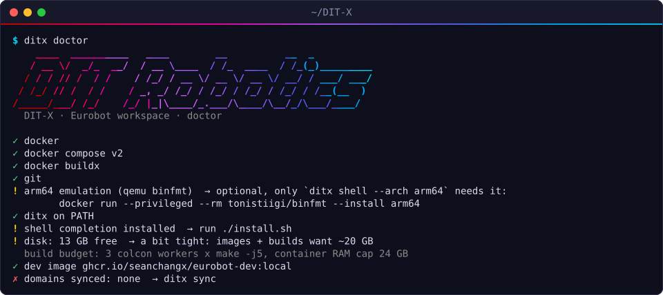

# 01 安裝

**目標**：在你的電腦上建立 DIT-X 工作區，並確認 `ditx doctor` 沒有任何 ✗ 項目。

**時間**：約 20 分鐘

## 背景

DIT-X 將 ROS 2、編譯器與 linter 全部封裝在 Docker image 中。你的電腦**只需要安裝 Git、Python 3 與 Docker**，不需要（也不應該）在主機上安裝 ROS。如此一來，每位成員的開發環境完全一致，可避免「在我的電腦上可以執行」這類問題。

## 前置條件

- Ubuntu 22.04 或 24.04（其他 Linux 發行版也可使用，但僅這兩個版本經過測試）
- 至少 20 GB 的可用磁碟空間（用於 image 與建置產物）
- GitHub 帳號已設定 SSH 金鑰，並已收到 DIT-X 與各 domain repo 的存取邀請（collaborator）

## 步驟

### 1. 安裝 Docker 與 Git

依照 [Docker 官方文件](https://docs.docker.com/engine/install/ubuntu/) 安裝 Docker Engine，然後將你的帳號加入 `docker` 群組（加入後須**登出再重新登入**才會生效）：

```bash
sudo usermod -aG docker $USER
```

確認安裝結果：

```bash
docker run --rm hello-world
git --version
```

### 2. 設定 Git 使用者名稱

部署至機器人時，部署紀錄會記載此名稱，請使用隊友能辨識的名字：

```bash
git config --global user.name "你的名字"
git config --global user.email "you@example.com"
```

### 3. 取得工作區並安裝 `ditx`

```bash
git clone git@github.com:SeanChangX/DIT-X.git && cd DIT-X
./install.sh
exec $SHELL          # 重開 shell，讓 PATH 與 Tab 補全生效
```

`./install.sh` 會執行下列動作：

- 在 `~/.local/bin/ditx` 建立連結，讓你能在任何目錄執行 `ditx`
- 在 `~/.bashrc` / `~/.zshrc` 加入一段帶有標記的設定（Tab 自動完成、`ditx cd`）
- 可重複執行；若要移除，請執行 `./install.sh --uninstall`

!!! note "安裝程式會變更哪些內容？"
    安裝程式只會修改 `~/.local/bin/ditx` 以及 rc 檔中 `# >>> ditx (DIT-X) >>>` 標記的區段，不會使用 sudo，也不會安裝任何系統套件。

### 4. 設定你的小組

```bash
ditx init
```

`ditx init` 會逐項詢問並寫入工作區的 `.env`（只存在你的電腦，不會 commit）。其中最重要的是**你在機器人上的帳號**：[DIT-Scripts](https://github.com/DIT-ROBOTICS/DIT-Scripts) 在每台機器人上為每個小組建立一個帳號，請填你所屬的小組（`main`、`navigation`、`localization` 或 `vision`）。之後 `ditx deploy`、`ditx logs` 等連到機器人的指令都會用這個帳號登入。其餘項目直接按 ++enter++ 使用預設值即可。

### 5. 健康檢查

```bash
ditx doctor
```

預期輸出如下：



- **✓**：檢查通過
- **!**：提醒事項，不影響使用（例如未啟用 arm64 模擬、機器人未開機）
- **✗**：需要處理，箭頭後方即為解決方式

此時出現 `domains synced: none` 與 dev image 的 ✗ 屬於正常現象，下一篇教學將會處理。

## 摘要

- 主機只需要 Git、Python 3 與 Docker
- `ditx` 已加入 PATH，並支援 Tab 自動完成（輸入 `ditx b` 後按 ++tab++ 即可試用）
- `ditx init` 設定你的小組帳號，`ditx doctor` 會列出缺少的項目與修正方式

## 下一步

[02 第一次建置與測試](02-first-build.md)：取得各小組的程式碼，並進行建置與測試。
