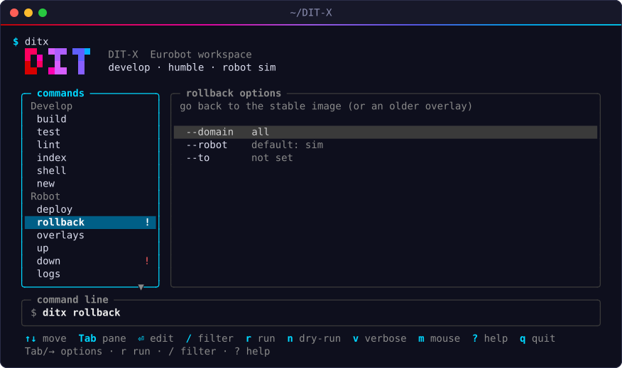
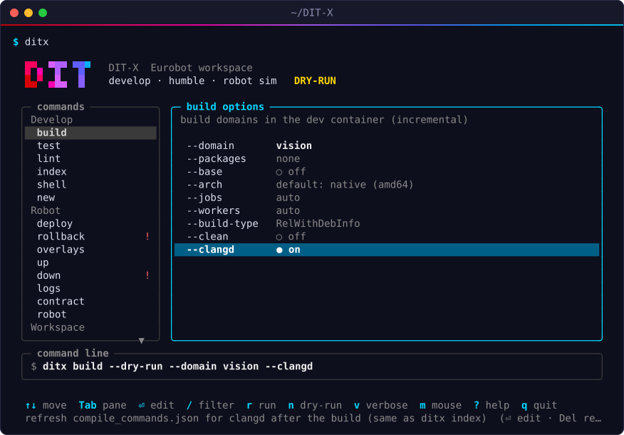
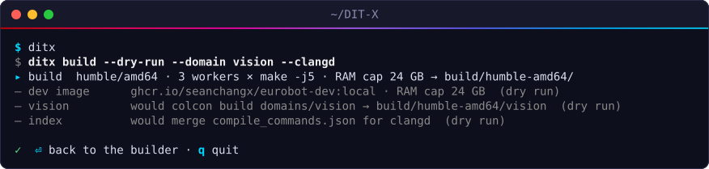

# 03 認識 TUI

**目標**：使用互動式介面（TUI）組合並執行指令，讓你不需記憶指令也能操作 `ditx`。

**時間**：約 10 分鐘

## 背景

直接輸入 `ditx`（不加任何參數）即可進入 TUI。TUI 並非另一套獨立功能，而是一個**指令產生器**：

- 在左側選擇指令，在右側調整選項
- 最下方的 **command line** 會即時顯示對應的 `ditx …` 指令
- 按下 ++r++ 即執行底部顯示的指令，執行完畢後可返回 TUI 繼續操作

因此，TUI 也是學習 CLI 最快的方式：多觀察幾次底部的指令，之後就能直接在終端機輸入。

## 前置條件

- 完成 [02 第一次建置與測試](02-first-build.md)

## 步驟

### 1. 啟動 TUI

```bash
ditx
```



- 取得焦點的窗格邊框會反白顯示，選取的項目會以整列色條標示
- 指令旁的 **`!`** 表示執行前會要求你確認（例如 `rollback`、`down`、`clean`）

### 2. 常用按鍵

| 按鍵 | 作用 |
|---|---|
| ++arrow-up++ ++arrow-down++ 或 ++j++ ++k++ | 移動 |
| ++tab++ 或 ++arrow-left++ ++arrow-right++ | 在「指令」與「選項」兩個窗格之間切換 |
| ++enter++ 或 ++space++ | 編輯選項：切換旗標、開啟選單、輸入文字 |
| ++del++ / ++backspace++ / ++x++ | 將選項還原為預設值 |
| ++slash++ | 篩選指令（++esc++ 清除） |
| ++g++ ++shift+g++、++page-up++ ++page-down++ | 跳至開頭或結尾、翻頁 |
| ++r++ | 執行底部顯示的指令 |
| ++n++ / ++v++ | 切換 `--dry-run` / `--verbose`（標頭會顯示對應標記） |
| ++m++ | 切換滑鼠捕捉；關閉時可用滑鼠選取並複製畫面上的文字 |
| ++question++ | 說明 |
| ++q++ | 離開（++esc++ 只會返回上一層，不會離開） |

滑鼠操作：按一下可選取項目，對已選取的選項再按一下即可編輯，滾輪可捲動游標所在的窗格。若要在啟用滑鼠捕捉時複製文字，請按住 ++shift++ 再拖曳。

### 3. 組合指令（僅預覽，不執行）

1. 使用 ++arrow-down++ 移至 **build**，按 ++tab++ 進入選項窗格
2. 在 `--domain` 上按 ++enter++ 開啟多選清單；輸入 `vis` 進行篩選，按 ++space++ 勾選 `vision`，再按 ++enter++ 確認
3. 移至 `--clangd`，按 ++space++ 啟用
4. 確認底部顯示：`$ ditx build --domain vision --clangd`
5. 按 ++n++ 啟用 dry-run 模式（標頭會顯示 `DRY-RUN`），再按 ++r++

按下 ++r++ 之前，畫面應如下：



dry-run 只會列出將要執行的動作，不會實際進行建置。執行完畢後，畫面會顯示：



按 ++enter++ 返回 TUI。

### 4. 實際執行指令

選擇 **status** 並按 ++r++，畫面會列出各 repo 的狀態，按 ++enter++ 返回。按 ++q++ 離開 TUI。

!!! tip "TUI 會記住上次的選擇"
    下次輸入 `ditx` 時，TUI 會回到上次使用的指令與選項（儲存於 `~/.config/ditx/last.json`）。

## 摘要

- 不加參數執行 `ditx` 即可進入 TUI，底部會持續顯示對應的指令
- 按 ++n++ 啟用 dry-run，可預覽指令將執行的動作
- 熟悉後即可直接在終端機輸入指令；TUI 與 CLI 使用同一份定義，行為完全一致

## 下一步

[04 第一個套件](04-first-package.md)：在 vision domain 中新增一個發布 topic 的 node。
