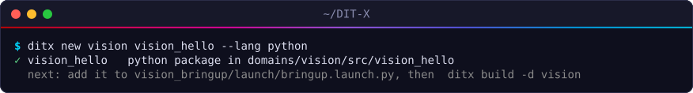
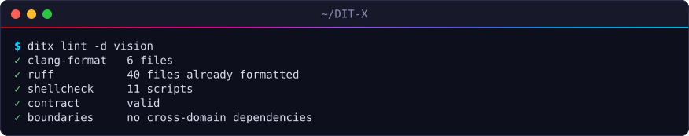
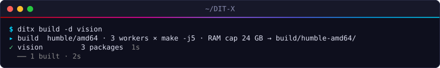
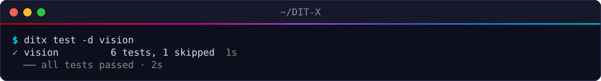

# 04 第一個套件

**目標**：在 vision domain 中新增 Python 套件（package）`vision_hello`，讓它每秒在 `/vision/hello`
發布一則訊息，並隨 vision domain 一同啟動。

**時間**：約 30 分鐘

## 背景

- 每個 domain 都是一個 colcon workspace，套件皆放在 `domains/<domain>/src/`
- 套件名稱**必須以 domain 名稱開頭**（`vision_…`），以避免各小組的套件名稱衝突；`ditx lint` 會檢查此規則
- 每個 domain 都有一個 `<domain>_bringup` 套件，其中的 `launch/bringup.launch.py`
  就是機器人上該 domain 容器實際執行的內容
- `ditx new` 會從範本產生一個**可直接建置與測試**的套件，你只需實作核心功能的部分

## 前置條件

- 完成 [02 第一次建置與測試](02-first-build.md)

## 步驟

### 1. 建立分支

```bash
ditx cd vision
git switch -c feat/hello
ditx cd
```

`ditx cd <domain 或 package>` 會切換至該目錄；不加參數執行 `ditx cd` 則會回到工作區根目錄。

### 2. 產生套件

```bash
ditx new vision vision_hello --lang python
```



產生的檔案如下：

```text
domains/vision/src/vision_hello/
├── package.xml
├── setup.py / setup.cfg / resource/vision_hello
├── vision_hello/
│   ├── hello.py          # 純邏輯：不碰 ROS，方便寫單元測試
│   └── hello_node.py     # ROS node：只負責收發資料
└── test/test_hello.py
```

!!! tip "為什麼要將邏輯與 node 分開？"
    `hello.py` 不 import ROS，因此測試執行快速，也容易撰寫。請將演算法放在這裡，node 只負責從 topic 接收資料並送出結果。

### 3. 撰寫邏輯與測試

`domains/vision/src/vision_hello/vision_hello/hello.py`：

```python
"""Pure logic of vision_hello: no ROS here, so it is easy to unit-test."""


def greeting(count):
    """Text of the count-th hello message."""
    return f'hello #{count} from vision'
```

`domains/vision/src/vision_hello/test/test_hello.py`：

```python
from vision_hello.hello import greeting


def test_greeting_counts():
    assert greeting(0) == 'hello #0 from vision'
    assert greeting(42).startswith('hello #42')
```

### 4. 撰寫 node

`domains/vision/src/vision_hello/vision_hello/hello_node.py`：

```python
"""hello_node of the vision domain: publishes a greeting on /vision/hello."""

from eurobot_common.startup import StartupReporter
import rclpy
from rclpy.node import Node
from std_msgs.msg import String

from vision_hello.hello import greeting


class HelloNode(Node):
    def __init__(self):
        super().__init__('hello')
        rate_hz = self.declare_parameter('rate_hz', 1.0).value
        self.pub = self.create_publisher(String, '/vision/hello', 10)
        self.count = 0
        self.create_timer(1.0 / rate_hz, self.tick)
        self.reporter = StartupReporter(self, 'vision', 'hello')  # (1)!
        self.reporter.ready()

    def tick(self):
        self.pub.publish(String(data=greeting(self.count)))
        self.count += 1


def main():
    rclpy.init()
    node = HelloNode()
    try:
        rclpy.spin(node)
    except KeyboardInterrupt:
        pass
    finally:
        node.destroy_node()
        if rclpy.ok():
            rclpy.shutdown()
```

1.  `StartupReporter` 會向 main 的 startup 回報「vision/hello 已就緒」，並每秒傳送 heartbeat。比賽開始前，main 會等待所有 domain 皆回報 ready。

由於使用了 `std_msgs`，請在 `package.xml` 中加入相依套件：

```xml
  <exec_depend>rclpy</exec_depend>
  <exec_depend>std_msgs</exec_depend>
```

### 5. 加入 bringup

在 `domains/vision/src/vision_bringup/launch/bringup.launch.py` 的 `nodes()` 中加入一個 Node：

```python
        Node(
            package='vision_hello',
            executable='hello_node',
            name='hello',
            parameters=params,
            output='screen',
            emulate_tty=True,
        ),
```

在 `domains/vision/src/vision_bringup/package.xml` 中加入：

```xml
  <exec_depend>vision_hello</exec_depend>
```

參數設定於 `domains/vision/src/vision_bringup/config/default.yaml`（key 為 node 的 `name`）：

```yaml
hello:
  ros__parameters:
    rate_hz: 1.0
```

!!! note "各機器人專屬的參數"
    請放在 `config/robots/<robot>.yaml`，只需填寫要覆寫的 key。不同機器人以設定檔區分，而非以 Git 分支區分。

### 6. 檢查、建置與測試

```bash
ditx lint -d vision
ditx build -d vision
ditx test -d vision
```







若格式不符規範，可執行 `ditx lint --fix` 自動修正。

### 7. 執行並驗證

`ditx shell` 會在 dev container 中開啟一個已完成環境 source 的 shell：

```bash
ditx shell
```

在容器中執行：

```bash
export ROS_AUTOMATIC_DISCOVERY_RANGE=LOCALHOST   # 只在這台電腦上找節點
ros2 launch vision_bringup bringup.launch.py &
ros2 topic echo --once /vision/hello
```

```text
data: 'hello #4 from vision'
---
```

執行 `ros2 node list`，應可看到 `/hello` 與原有的 `/rival`。輸入 `exit` 離開容器。

### 8. 提交變更

```bash
ditx cd vision
git add -A
git commit -m "feat(vision): add hello node"
```

提交訊息必須符合 Conventional Commits 格式（`type(scope): subject`）。Git hook 會進行檢查，格式錯誤時會提示正確格式。詳細說明請參閱 [09 Git 流程與 CI](../intermediate/09-git-ci.md)。

## 摘要

- `ditx new <domain> <domain>_<name>` 會產生可直接建置與測試的套件
- 將邏輯（可測試）與 node（負責收發資料）分開
- 新的 node 必須加入 `<domain>_bringup` 的 launch 檔與 `package.xml`，參數則放在 `config/`
- `/vision/hello` 目前僅在 vision 小組內部使用，因此不需要登錄至介面合約

## 下一步

[05 跨 domain 的 topic 與 QoS](05-contract.md)：若 main 也需要接收此訊息，就必須將它登錄至 `contract.yaml`。
