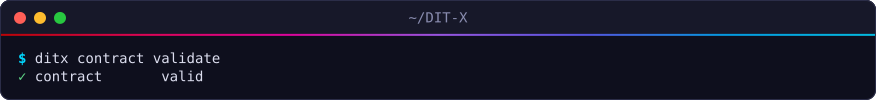
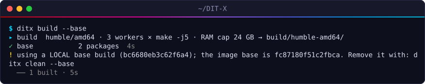
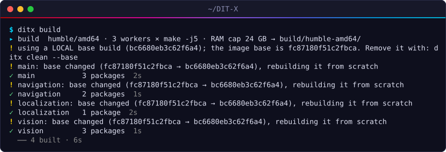
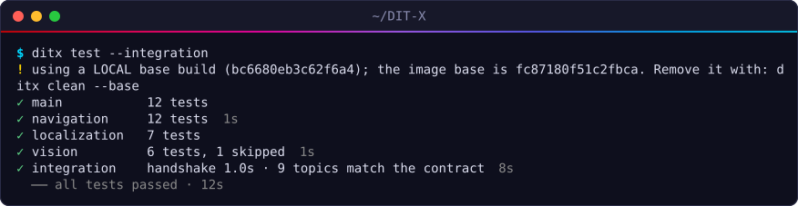

# 05 跨 domain 的 topic 與 QoS

**目標**：將 [04](04-first-package.md) 的 hello topic 登錄至介面合約（contract）`contract.yaml`，更名為 `/robot/vision/hello` 並選擇適當的 QoS，讓其他 domain（例如 main）能安全地訂閱。

**時間**：約 30 分鐘

## 背景

各小組之間**只能透過 topic / service 溝通**，不得直接相依其他小組的套件（`ditx lint` 的 boundaries 檢查會阻擋）。所有跨 domain 的 topic 皆登錄於 **`base/eurobot_common/contract.yaml`**，它是唯一的權威來源（single source of truth）：

- 建置時自動產生 C++ / Python 常數：`contract.VISION_HELLO.name`、`contract.VISION_HELLO.qos()`
  → 程式中不需手動輸入 topic 名稱，拼寫錯誤或型別不一致會在建置階段就被發現
- `ditx test --integration` 與 `ditx contract live -r <robot>` 會將實際執行中的 topic 與合約比對
- `ditx contract md` 會產生供人閱讀的 [介面合約文件](../../contract.md)

### 如何選擇 QoS

`contract.yaml` 僅提供四種 profile。請從中擇一使用，不要自行組合參數：

| profile | 設定 | 適用情境 | 原因 |
|---|---|---|---|
| `sensor` | best_effort · volatile · keep_last 1 | 位置、雷達、偵測、heartbeat | 只需要最新的一筆資料；reliable 會為了重送舊資料而延遲新資料 |
| `state` | reliable · transient_local · keep_last 1 | 「目前狀態」類，例如 startup status | 較晚啟動的 node 連線後即可取得最後一筆資料 |
| `command` | reliable · volatile · keep_last 10 | 目標點、任務指令 | 不允許遺失 |
| `stream` | reliable · volatile · keep_last 10 | 給第三方套件讀的高頻資料，例如給 nav2 的 odometry | nav2 等套件以 reliable 訂閱，best_effort 的 publisher 不會被接收 |

!!! warning "QoS 不相容時將無法接收資料"
    reliable 的 subscriber 無法接收 best_effort publisher 的資料，transient_local 的 subscriber 也無法接收 volatile publisher 的資料。只要雙方都使用 `contract.X.qos()`，即可避免此問題。

### action 與特殊 topic

- **action**：跨 domain 的 action（例如 main 請 navigation 執行 `DockRobot`）登錄在 `actions:` 區段，程式中使用 `contract.NAVIGATION_DOCK.name`。`contract_check` 會把 action 背後的隱藏 topic 視為已登錄。
- topic 可以加上以下旗標（預設皆為 false）：

| 旗標 | 意思 | 例子 |
|---|---|---|
| `firmware: true` | 名稱寫死在 micro-ROS 韌體裡，不受 `/robot/...` 命名規則限制；publisher 或 subscriber 可以寫 `firmware` | `/cmd_vel` |
| `external: true` | 名稱由機器人上 workspace 以外的系統決定（例如網頁儀表板），不受命名規則限制 | `/game_score` |
| `hardware: true` | 沒有實體硬體（韌體板、相機、GPU）就不會有 publisher；sim 的整合測試（`--require all`）不要求它，`--require everything` 會要求 | 相機偵測結果 |

## 前置條件

- 完成 [04 第一個套件](04-first-package.md)

## 步驟

### 1. 在 contract.yaml 中登錄

在 `base/eurobot_common/contract.yaml` 的 `topics:` 下方加入：

```yaml
  VISION_HELLO:
    name: /robot/vision/hello
    type: std_msgs/msg/String
    qos: sensor
    publisher: vision
    subscribers: [main]
    rate_hz: 1
    doc: Tutorial example, a greeting from the vision domain.
```

規則：key 一律使用全大寫；名稱格式為 `/robot/<area>/<thing>`（area 通常為負責的 domain）；型別格式為 `pkg/msg/Type`。執行檢查：

```bash
ditx contract validate
```



### 2. 讓 node 改用合約常數

修改 `hello_node.py` 中的兩處：

```python
from eurobot_common import contract
from eurobot_common.startup import StartupReporter
...
        topic = contract.VISION_HELLO
        self.pub = self.create_publisher(String, topic.name, topic.qos())
```

若 main 要訂閱，寫法相同（範例）：

```python
self.create_subscription(String, contract.VISION_HELLO.name, self.on_hello,
                         contract.VISION_HELLO.qos())
```

### 3. 重新建置共用介面與所有 domain

`contract.yaml` 位於 `base/` 中，由**所有小組共用**。因此，你必須先在本機建置新的 base，再讓每個 domain 以它為基礎重新建置：

```bash
ditx build --base
ditx build
```





- `using a LOCAL base build`：提醒你目前使用的是本機建置的 base，而非 image 中的版本
- `base changed … rebuilding it from scratch`：介面已變更，`ditx` 會自動為每個 domain 重新執行 configure

### 4. 系統測試

```bash
ditx test --integration
```



topic 數量從原本的 8 個增加為 9 個，新增的是 `/robot/vision/hello`。

!!! failure "若忘記重新建置 vision"
    整合測試會失敗，日誌中會出現 `FAIL  no publisher on /robot/vision/hello`：合約已登錄新 topic，但執行的仍是舊程式（仍在發布 `/vision/hello`）。執行 `ditx build` 後再重新測試即可。

### 5. 更新文件並送出 PR

```bash
ditx contract md         # 重新產生 docs/contract.md
```

本次變更涉及**兩個 repo**：shell repo 中的 `contract.yaml` 與 `docs/contract.md`，以及 Eurobot-Vision 中的 node。修改共用介面的 PR 須經組長審查（CODEOWNERS），合併後 CI 會發布新的 base image。詳細流程請參閱 [11 修改共用介面](../advanced/11-interfaces.md)。

## 摘要

- 跨 domain 的 topic 一律登錄於 `contract.yaml`，程式中使用自動產生的常數
- QoS 從 `sensor` / `state` / `command` / `stream` 中擇一使用
- 名稱不由我們決定的 topic 用 `firmware` / `external` 標記，需要實體硬體才有 publisher 的用 `hardware` 標記
- 修改 `base/` 即修改所有小組共用的介面，請依序執行 `ditx build --base` → `ditx build` → `ditx test --integration`

## 下一步

[06 模擬機器人](06-sim-robot.md)：以與機器人相同的方式（Docker image + compose），在你的電腦上執行整套系統。
