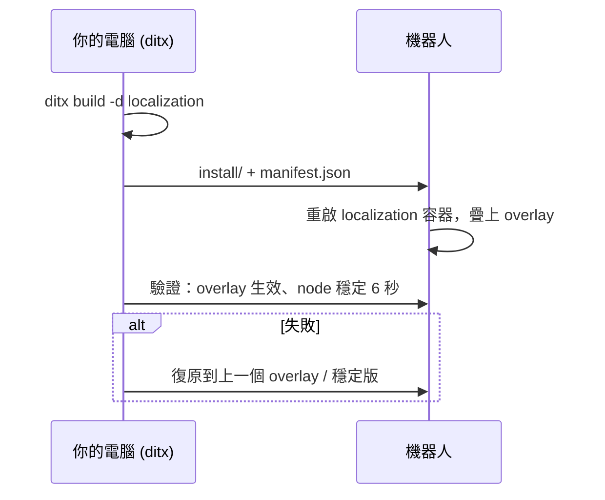
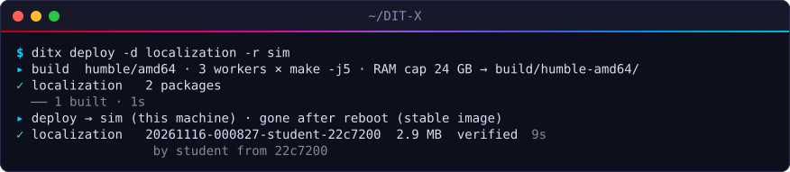
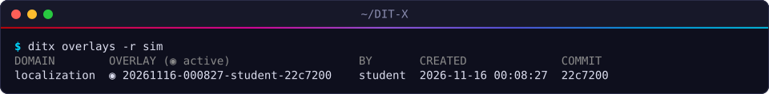
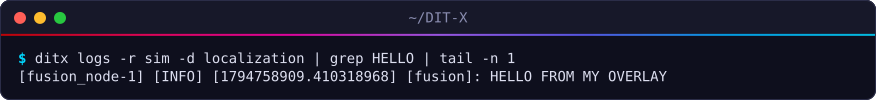
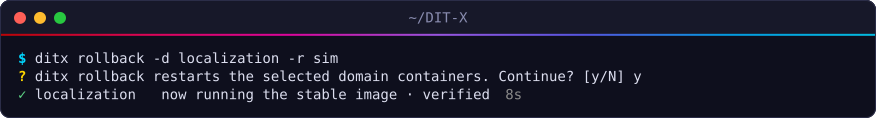
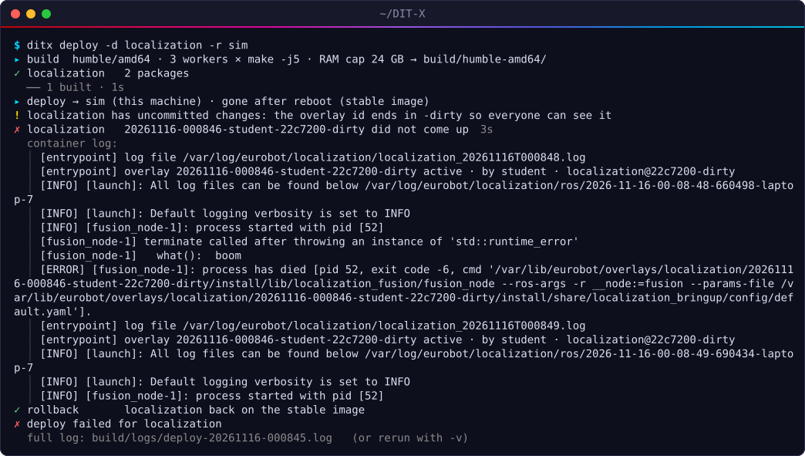
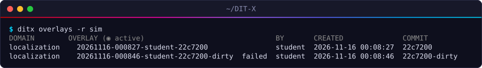

# 07 部署 overlay 與復原

**目標**：修改一行 localization 的程式，將**建置產物**部署到機器人、確認其正在執行，再予以復原；最後刻意部署一個會當機的版本，觀察 `ditx` 如何自動復原。

**時間**：約 20 分鐘

## 背景

機器人平時執行的是 CI 建置的**穩定版 image**。開發時不需要重建 image，流程如下：

1. 在自己的電腦上建置（`ditx build`）。
2. 只將該 domain 的 `install/` 連同一份 manifest（部署者、時間、commit）封裝成 **overlay** 並推送到機器人。
3. 容器重新啟動時，將 overlay 疊加在 image 之上。
4. `ditx` 確認 overlay 確實生效，且 node 沒有當機（verified）；若驗證失敗，則自動復原至上一個版本。

overlay 預設存放在機器人的 `/run`，**重新開機後即會消失**，因此比賽當天一律從 CI 的穩定版開始。若要保留，請加上 `--persist`。



## 前置條件

- 已完成 [06 模擬機器人](../beginner/06-sim-robot.md)，且 `ditx up -r sim` 正在執行

## 步驟

### 1. 修改程式並提交

```bash
ditx cd localization_fusion
git switch -c feat/try
sed -i 's/^\(\s*\)reporter_->ready();/\1RCLCPP_INFO(get_logger(), "HELLO FROM MY OVERLAY");\n&/' src/fusion_node.cpp
git commit -qam "feat(fusion): say hello"
```

### 2. 部署

```bash
ditx deploy -d localization -r sim
```



overlay 名稱由「時間 + 你的 Git 名稱 + commit」組成，可一眼看出部署者與來源版本。

### 3. 確認

```bash
ditx overlays -r sim
ditx logs -r sim -d localization | grep HELLO
```





### 4. 復原

```bash
ditx rollback -d localization -r sim
```



使用 `--to <overlay id>` 可切換回較舊的 overlay。

### 5. 刻意部署有問題的版本

```bash
sed -i 's/RCLCPP_INFO(get_logger(), "HELLO FROM MY OVERLAY");/throw std::runtime_error("boom");/' src/fusion_node.cpp
ditx deploy -d localization -r sim
```



- 若有尚未提交的修改，overlay 名稱會加上 `-dirty`，所有人都能看到。
- node 當機時，`ditx` 會印出容器日誌，並自動復原。
- 若要保留失敗的現場以便除錯，請加上 `--no-rollback`。

`ditx overlays -r sim` 會將其標示為 `failed`：



### 6. 清理

```bash
git checkout -- . && git switch -q develop
ditx cd
```

## 摘要

- `ditx deploy` 的流程為：建置 → 只推送建置產物 → 重新啟動 → 驗證 → 失敗時自動復原。
- `ditx overlays` 可查看機器人目前執行的是哪位成員的哪個 commit。
- 重新開機後會回到穩定版；只有加上 `--persist` 才會保留 overlay。

## 下一步

[08 日誌與除錯](08-debugging.md)
