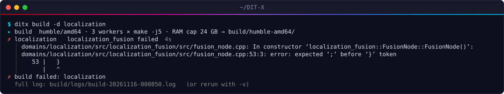
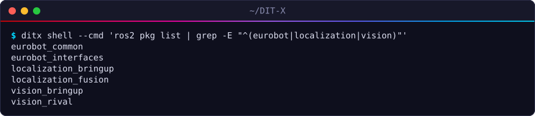
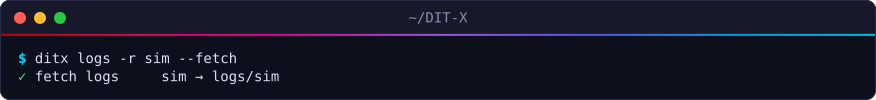

# 08 日誌與除錯

**目標**：了解發生錯誤時應查看何處、如何取得完整輸出，以及如何進入容器使用 `ros2` 指令。

## 背景

`ditx` 平時每個步驟只印出一行；各工具（colcon、Docker、Git）的完整輸出會寫入 `build/logs/<指令>-<時間>.log`。失敗時只會印出**與錯誤相關的幾行**，並提供日誌檔的路徑。

## 前置條件

- 已完成 [07 部署 overlay 與復原](07-deploy.md)

## 步驟

### 1. 檢視編譯錯誤

刻意刪除 `fusion_node.cpp` 中的一個分號，然後執行：

```bash
ditx build -d localization
```



路徑皆相對於工作區，可直接在編輯器中開啟。修正後重新建置即可。

### 2. 查看完整輸出

| 目的 | 指令 |
|---|---|
| 將所有輸出直接印在畫面上 | `ditx build -v` |
| 只顯示將執行的動作，不實際執行 | `ditx -n build`（dry-run） |
| 只顯示錯誤與警告 | `ditx -q build` |
| 事後查閱日誌 | `build/logs/` 中最新的檔案 |

### 3. 在容器中除錯

```bash
ditx shell
```

此指令會在 dev container 中開啟 Bash，ROS 與所有已建置的 domain 皆已完成 source，可直接使用：

```bash
ros2 pkg list | grep -E "^(eurobot|localization|vision)"
ros2 launch vision_bringup bringup.launch.py
ros2 topic echo /robot/vision/rival_poses
```

若只需執行單一指令：

```bash
ditx shell --cmd 'ros2 pkg list | grep -E "^(eurobot|localization|vision)"'
```



!!! tip "在容器中執行 ROS node 時"
    請先執行 `export ROS_AUTOMATIC_DISCOVERY_RANGE=LOCALHOST`，避免與網路上其他人的 node 互相干擾。

### 4. 機器人上的日誌

```bash
ditx logs -r sim -d localization -f      # 即時追蹤
ditx logs -r sim --fetch                 # 整個日誌資料夾 → logs/sim/
```



每個容器的日誌檔名為 `<容器>_<啟動時間>.log`，第一行會記載執行的是穩定版或是哪個 overlay（含 commit），因此每份日誌都能追溯到產生它的程式版本。機器人上的日誌存放於 `/home/share/eurobot/logs/`，保留 7 天或最多 100 GB，並於每晚同步至實驗室 NAS（請參閱 [Logging](../../logging.md)）。

## 摘要

- 失敗時先查看 `✗` 下方的幾行；若資訊不足，請查看 `build/logs/` 或加上 `-v`。
- `ditx shell` 提供已設定完成的 ROS 環境。
- `ditx logs` 用於查看機器人日誌，`--fetch` 可將日誌下載至本機分析。

## 下一步

[09 Git 流程與 CI](09-git-ci.md)
