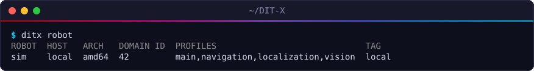
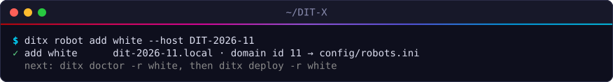
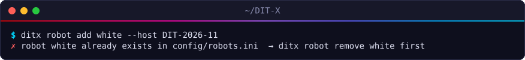
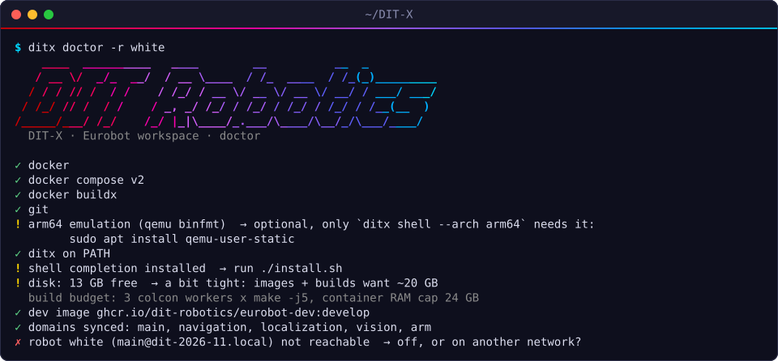
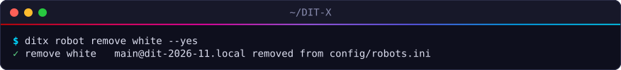

# 10 管理機器人

**目標**：將一台實體機器人登錄至 `config/robots.ini`，以便使用 `-r <名字>` 指定該機器人。

**時間**：約 5 分鐘

## 背景

在 DIT-X 中，「機器人」是一筆**設定**，而不是 Git 分支。`config/robots.ini` 預設只包含 `sim`；每台實體機器人需以 `ditx robot add` 新增，用法與 `git remote` 相同：

| 指令 | 作用 |
|---|---|
| `ditx robot` / `ditx robot list` | 列出所有機器人 |
| `ditx robot add <名字> --host <hostname>` | 新增 |
| `ditx robot remove <名字>` | 移除（執行前會先確認） |

各機器人專屬的參數（例如輪距、相機位置）不放在此處，而是放在各 domain 的
`<domain>_bringup/config/robots/<robot>.yaml`，且只覆寫 `default.yaml` 中既有的 key。

## 前置條件

- 已完成 [06 模擬機器人](../beginner/06-sim-robot.md)。
- 已知機器人的 hostname（例如 `DIT-2026-11`），且能透過 SSH 登入（請參閱 [14](../advanced/14-real-robot.md)）。

## 步驟

### 1. 列出目前的機器人

```bash
ditx robot
```



### 2. 新增機器人

```bash
ditx robot add white --host DIT-2026-11
```



機器人的 hostname 依照 [DIT-Scripts](https://github.com/DIT-ROBOTICS/DIT-Scripts) 的規則命名：`DIT-<年份>-<固定 IP 最後一碼>`，DIT-Scripts 也會將 `ROS_DOMAIN_ID` 設為該數字。因此只需提供 hostname，`ditx` 就會自動補齊其餘欄位：

| 輸入的 `--host` | 寫入 `robots.ini` 的 host | domain id |
|---|---|---|
| `DIT-2026-11` | `dit-2026-11.local`（mDNS） | 11 |
| `navigation@DIT-2026-13` | `navigation@dit-2026-13.local` | 13 |
| `dit@192.168.0.50`、`~/.ssh/config` 中的 Host 別名 | 保持原樣 | 下一個未使用的號碼 |

!!! note "每個人用自己小組的帳號登入"
    DIT-Scripts 會在機器人上為每個小組建立一個帳號（`main`、`navigation`、`localization`、`vision`）。`robots.ini` 是全隊共用的檔案，因此只記錄 hostname，不記錄帳號；連線時 `ditx` 會用你在 `ditx init` 設定的帳號（`.env` 中的 `DIT_ROBOT_USER`）。例如 vision 組的同學執行 `ditx deploy -r white`，實際登入的是 `vision@dit-2026-11.local`。

    這些帳號都在機器人的 `docker` 群組裡，機器人上的資料夾也是整個群組共用，所以不論誰部署，其他人都能接手操作。若某台機器人一定要用特定帳號，請加上 `--user`，或直接指定 `user@hostname`，帳號就會寫入 `robots.ini`。

其他選項（皆有預設值）：

| 選項 | 預設 | 說明 |
|---|---|---|
| `--user` | 你的 `DIT_ROBOT_USER` | 將特定的 SSH 帳號寫入 `robots.ini`（所有人都用這個帳號連線） |
| `--domain-id` | hostname 中的數字 | 僅在硬體或網路未遵循命名規則時需要指定 |
| `--arch` | `amd64` | `arm64`：Raspberry Pi、Jetson（請參閱 [14](../advanced/14-real-robot.md)） |
| `--profiles` | 所有 domain | 此機器人執行的容器；額外選項包括 `firmware`（micro-ROS agent）與 `monitoring`（netdata） |
| `--tag` | `stable` | 要執行的 image：`stable`、`develop` 或固定版本 `vX.Y.Z` |

`config/robots.ini` 會新增以下內容：

```ini
[white]
host = dit-2026-11.local
arch = amd64
domain_id = 11
profiles = main,navigation,localization,vision
tag = stable
```

檔案中原有的註解會保留，因此也可以直接手動編輯。

名稱重複時會遭到拒絕：



### 3. 檢查連線

```bash
ditx doctor -r white
```



連線成功時會顯示 `✓`。無法連線的常見原因包括：機器人未開機、你與機器人不在同一個網路，或尚未設定 SSH 金鑰（請參閱 [14](../advanced/14-real-robot.md)）。

### 4. 移除

```bash
ditx robot remove white
```



執行前會先以 `[y/N]` 確認；在腳本中請加上 `--yes`。

## 摘要

- 使用 `ditx robot add/list/remove` 管理 `config/robots.ini`。
- 每台機器人的 domain id 必須不同，以免在同一個網路上互相干擾。
- 機器人專屬參數放在 `<domain>_bringup/config/robots/<robot>.yaml`。

## 下一步

進階：[11 修改共用介面](../advanced/11-interfaces.md)
